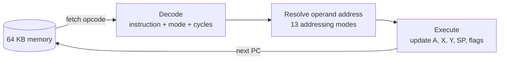

<div align="center">

# MOS 6502 Emulator

**The 8-bit CPU from the Apple II, Commodore 64 and NES, rebuilt in Rust by hand.**


</div>

---

I wanted to see how a CPU really works, cycle by cycle, so I'm building one myself instead of using a library. No crates, no shortcuts: buses, registers, flags, addressing modes and clock cycles, written out one instruction at a time.

## ✅ What works

| | |
|---|---|
| **Instructions** | All 151 official opcodes |
| **Addressing modes** | All 13 |
| **Timing** | Cycle counting, with page-cross and branch penalties |
| **Testing** | Passes every binary-mode group of [Klaus Dormann's 6502 functional test](https://github.com/Klaus2m5/6502_65C02_functional_tests) |

## 🧠 How it works



| Region | Address |
|---|---|
| Zero page | `$0000-$00FF` |
| Stack | `$0100-$01FF` |
| Program load | `$0600` |
| NMI / Reset / IRQ vectors | `$FFFA-$FFFF` |

Status register: `N V - B D I Z C`

## 🚀 Run it

```bash
git clone https://github.com/SlainST/CPU_6502.git
cd CPU_6502
cargo run
```

It loads `target_assembly/emulate.bin` at `$0600`, runs until `BRK` and prints the registers. The default program fills `$0200-$020F` with 0-15:

```
A: $0F,   X: $10,   Y: $00,   status register as whole: $27,   SP: $FD,   PC: $060C,
```

To run something else, assemble it to a raw binary and replace `emulate.bin`.

## 🛠️ Roadmap

- [ ] Decimal (BCD) mode for ADC / SBC
- [ ] IRQ / NMI
- [ ] 1 MHz speed limit using the cycle counter
- [ ] Step limit and memory dump
- [ ] Trace mode (maybe)

## 📚 References

- [6502.org](http://www.6502.org/)
- [Obelisk 6502 reference](https://www.nesdev.org/obelisk-6502-guide/)
- [Klaus Dormann's functional tests](https://github.com/Klaus2m5/6502_65C02_functional_tests)

---

<sub>This README was drafted with AI help from my notes. The emulator code is mine; some comments in the source are reference notes (partly AI-assisted) I keep to look at while coding.</sub>
